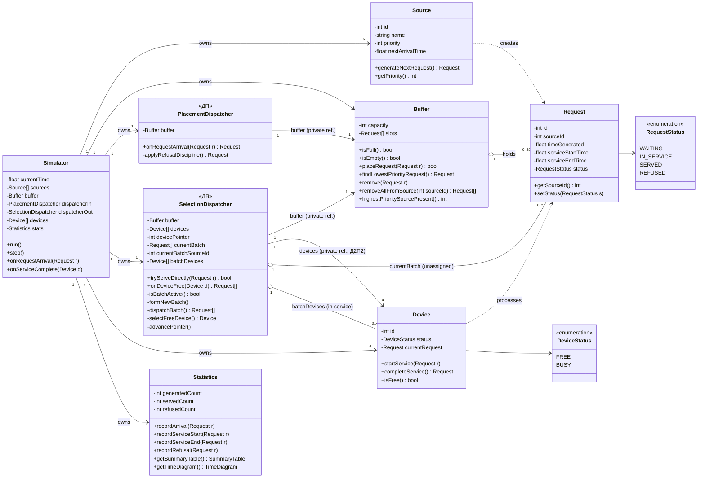
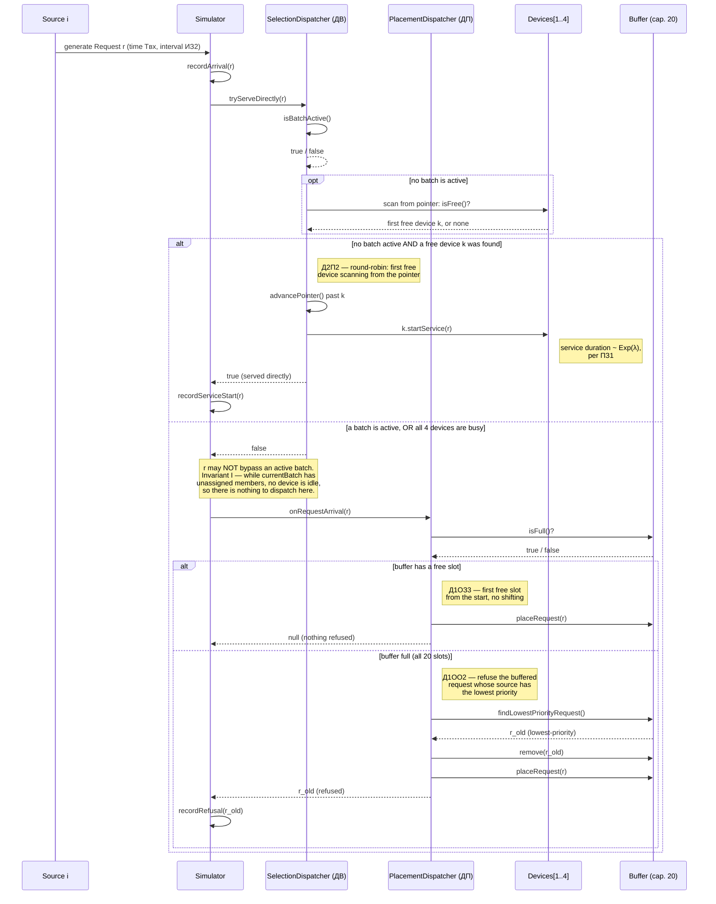
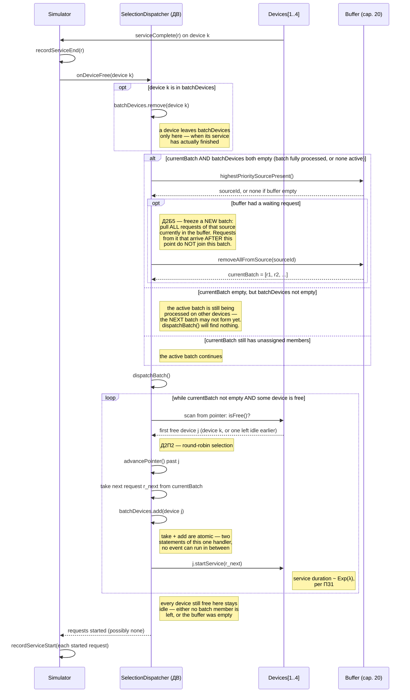

# СМО (Queuing System) — Variant 24. Primary Design Artifacts (Stage 2)

Domain: **Commodity Trading and Supply Chain Management Platform**
Variant 24: `ИБ · ИЗ2 · ПЗ1 · Д1ОЗ3 · Д1ОО2 · Д2П2 · Д2Б5 · ОР1 · ОД3`

Design of a discrete-event simulation model of a queuing system (СМО) for a commodity trading
and supply chain platform. The model consists of 5 sources (Buyer System, Supplier System,
Logistics System, Warehouse/Inventory System, Internal Trading System — the source number sets
the priority: source 1 is the highest, source 5 the lowest), a 20-slot buffer, 4 service devices
(Worker 1–4), a placement dispatcher **ДП** (disciplines Д1ОЗ3 + Д1ОО2) and a selection
dispatcher **ДВ** (disciplines Д2П2 + Д2Б5). Both dispatchers are algorithmic components of the
model, not human roles. Discipline codes are written in their standard notation.

## Repository Contents

| File | Description |
|---|---|
| `hegazy_V24_BusinessDomain.pdf` | Stage 1 — business domain description |
| `hegazy_V24_mapping.pdf` | Stage 1 — mapping of the domain onto the СМО model |
| `class-diagram.mmd` / `.png` | Class diagram |
| `main-sequence.mmd` / `.png` | Main sequence diagram — full request lifecycle |
| `sequence-arrival.mmd` / `.png` | Sequence diagram — request arrival |
| `sequence-device-free.mmd` / `.png` | Sequence diagram — device becomes free |
| `flowchart-swimlanes.mmd` / `.png` | Flowchart with swimlanes |

## 0. Stage 1 — Business Domain & Mapping

- [hegazy_V24_BusinessDomain.pdf](hegazy_V24_BusinessDomain.pdf)
- [hegazy_V24_mapping.pdf](hegazy_V24_mapping.pdf)

## 1. Class Diagram

**Design notes:**
- `Source` is one class with 5 instances (not 5 subclasses) — they differ only in `name` and
  `priority`. `priority` is the source number (a lower number means a higher priority, as defined in the
  Stage 1 mapping) and is what Д1ОО2 and Д2Б5 compare.
- `Request` is the final, agreed definition of "Заявка": one complete trade/order operation
  from a single source (not its internal steps).
- Every attribute is **private** (`-`); only the operations a collaborator actually needs are
  public (`+`). Both dispatchers hold the `Buffer` through a **private** field, and ДВ also
  holds the `Device` array privately (it needs it for the Д2П2 round-robin scan) — so callers
  never pass internal structures as parameters.
- The dispatchers **return** their results instead of reaching back into the `Simulator`:
  `PlacementDispatcher.onRequestArrival(r)` returns the refused request (or `null`),
  `SelectionDispatcher.tryServeDirectly(r)` returns whether `r` was put straight into service,
  and `SelectionDispatcher.onDeviceFree(d)` returns the list of requests it started. The
  `Simulator` then records the corresponding statistics.
- `SelectionDispatcher` (ДВ) owns device selection (Д2П2) and batch selection (Д2Б5). Its
  public interface is just `tryServeDirectly(r)` (arrival event) and `onDeviceFree(d)`
  (service-completion event); everything else — `isBatchActive()`, `formNewBatch()`,
  `dispatchBatch()`, `selectFreeDevice()`, `advancePointer()` — is private.
- Batch state in ДВ: `currentBatch` holds the frozen batch's members **not yet assigned** to a
  device, `currentBatchSourceId` records which source it was frozen from, and `batchDevices`
  holds the devices **currently in service** on a batch member.
  `isBatchActive() = !currentBatch.isEmpty() || !batchDevices.isEmpty()`.
- `Statistics` is kept separate from `Simulator` so it can feed both ОР1 (summary table) and
  ОД3 (time diagrams / live state) without duplicating counting logic. `getTimeDiagram()` here
  only means "the data this class can supply for ОД3" — it is not a separate diagram
  artifact at this stage.

## 2. Main Sequence Diagram — Full Request Lifecycle

This is the primary sequence diagram: it follows one request from generation all the way
through to service, showing every alternative branch required by variant 24 (immediate
service, buffering, refusal, and the batch-aware device-free path) in a single flow. Every
query whose answer decides a branch (`isFree()`, `isFull()`, `highestPrioritySourcePresent()`,
`tryServeDirectly()`, `onRequestArrival()`) shows its return message before the branch.

```mermaid
sequenceDiagram
    participant S as Source i
    participant Sim as Simulator
    participant ДВ as SelectionDispatcher (ДВ)
    participant ДП as PlacementDispatcher (ДП)
    participant D as Devices[1..4]
    participant B as Buffer (cap. 20)

    loop every inter-arrival interval (ИЗ2 — uniform distribution)
        S->>Sim: generate Request r (time Tвх)
        Sim->>Sim: recordArrival(r)
        Sim->>ДВ: tryServeDirectly(r)
        ДВ->>ДВ: isBatchActive()
        ДВ-->>ДВ: true / false
        opt no batch is active
            ДВ->>D: scan from pointer: isFree()?
            D-->>ДВ: first free device k, or none
        end

        alt no batch active AND a free device k was found
            Note right of ДВ: Д2П2 — round-robin: first free<br/>device scanning from the pointer
            ДВ->>ДВ: advancePointer() past k
            ДВ->>D: k.startService(r)
            Note right of D: service duration ~ Exp(λ),<br/>per ПЗ1
            ДВ-->>Sim: true (served directly)
            Sim->>Sim: recordServiceStart(r)
        else a batch is active, OR all 4 devices are busy
            ДВ-->>Sim: false
            Note over Sim,ДВ: r may NOT bypass an active batch.<br/>Invariant I — while currentBatch has<br/>unassigned members, no device is idle,<br/>so there is nothing to dispatch here.
            Sim->>ДП: onRequestArrival(r)
            ДП->>B: isFull()?
            B-->>ДП: true / false
            alt buffer has a free slot
                Note right of ДП: Д1ОЗ3 — first free slot<br/>from the start, no shifting
                ДП->>B: placeRequest(r)
                ДП-->>Sim: null (nothing refused)
            else buffer full (all 20 slots)
                Note right of ДП: Д1ОО2 — refuse the buffered<br/>request whose source has<br/>the lowest priority
                ДП->>B: findLowestPriorityRequest()
                B-->>ДП: r_old (lowest-priority)
                ДП->>B: remove(r_old)
                ДП->>B: placeRequest(r)
                ДП-->>Sim: r_old (refused)
                Sim->>Sim: recordRefusal(r_old)
            end
            Note over B: r now waits in the buffer
        end
    end

    Note over D,B: ... simulated time passes, eventually<br/>device k finishes the request it was serving ...

    D->>Sim: serviceComplete(r_prev) on device k
    Sim->>Sim: recordServiceEnd(r_prev)
    Sim->>ДВ: onDeviceFree(device k)

    opt device k is in batchDevices
        ДВ->>ДВ: batchDevices.remove(device k)
        Note right of ДВ: a device leaves batchDevices<br/>only here — when its service<br/>has actually finished
    end

    alt currentBatch AND batchDevices both empty (batch fully processed, or none active)
        ДВ->>B: highestPrioritySourcePresent()
        B-->>ДВ: sourceId, or none if buffer empty
        opt buffer had a waiting request (here: source i of r)
            Note right of ДВ: Д2Б5 — freeze a NEW batch:<br/>pull ALL of source i's requests<br/>currently in the buffer (incl. r).<br/>Requests from source i that arrive<br/>after this point do NOT join it.
            ДВ->>B: removeAllFromSource(i)
            B-->>ДВ: currentBatch = [..., r, ...]
        end
    else currentBatch empty, but batchDevices not empty
        Note right of ДВ: the active batch is still being<br/>processed on other devices —<br/>the NEXT batch may not form yet.<br/>dispatchBatch() will find nothing.
    else currentBatch still has unassigned members
        Note right of ДВ: the active batch continues
    end

    ДВ->>ДВ: dispatchBatch()
    loop while currentBatch not empty AND some device is free
        ДВ->>D: scan from pointer: isFree()?
        D-->>ДВ: first free device j (device k, or one left idle earlier)
        Note right of ДВ: Д2П2 — round-robin selection
        ДВ->>ДВ: advancePointer() past j
        ДВ->>ДВ: take next request from currentBatch
        ДВ->>ДВ: batchDevices.add(device j)
        Note right of ДВ: take + add are atomic — two<br/>statements of this one handler,<br/>no event can run in between
        ДВ->>D: j.startService(request)
        Note right of D: service duration ~ Exp(λ),<br/>per ПЗ1
    end
    Note right of ДВ: every device still free here stays<br/>idle — either no batch member is<br/>left, or the buffer was empty
    ДВ-->>Sim: requests started [..., r, ...]
    Sim->>Sim: recordServiceStart(each started request)

    Note over Sim,D: Request r has been generated, buffered<br/>(surviving an eviction round), frozen into<br/>a batch only after the previous batch fully<br/>finished, and dispatched to a free device.
```

### Д2Б5 — Batch Discipline

1. **Batch formation.** A new batch forms only when no batch is active (`currentBatch` and
   `batchDevices` both empty). ДВ finds the highest-priority source that still has requests in
   the buffer and freezes **all** of that source's buffered requests into `currentBatch` at
   once. Requests from that source that arrive later do **not** join this batch.
2. **Dispatching.** After every device-free event — whether or not a batch was just formed —
   ДВ runs `dispatchBatch()`: while `currentBatch` still has unassigned members **and any**
   device is free, it picks the next free device by Д2П2 (round-robin from the pointer),
   advances the pointer past it, takes the next batch member, registers the device in
   `batchDevices`, and starts service. So when a new batch forms, **every** free device gets a
   member, not only the device whose completion triggered the event.
3. **Completion.** A device is removed from `batchDevices` only when its service finishes (the
   first step of `onDeviceFree()`). If `currentBatch` is empty but `batchDevices` is not, the
   batch is **not finished**: free devices stay idle and the next batch is not formed. Only
   when the last member's service completes does ДВ form the next batch.
4. **No bypassing.** A new arrival is served directly only if no batch is active **and** a free
   device exists. Otherwise it goes to ДП (buffer, Д1ОЗ3, or refusal, Д1ОО2) even if some device
   happens to be free.
5. **Atomicity.** "Take the next member out of `currentBatch`" and "add the device to
   `batchDevices`" are two statements of the same handler. The simulator is single-threaded
   and processes one event at a time to completion, so no other event can ever observe the
   state between them — `isBatchActive()` cannot wrongly read "no batch" mid-assignment.
6. **ПЗ1.** Every `startService()` call, direct or from a batch, draws its service duration from
   the exponential distribution.

### Invariants

- **Invariant I — no device is idle while `currentBatch` has unassigned members.**
  `currentBatch` gains members only inside `onDeviceFree()` (via `formNewBatch()`), which is
  immediately followed by `dispatchBatch()`; that loop stops only when `currentBatch` is empty
  or no device is free. A device becomes free only through service completion, which also
  calls `onDeviceFree()` → `dispatchBatch()`. Arrivals never free a device and never add to
  `currentBatch`. So the invariant holds after every event — and this is why the arrival path
  has nothing to dispatch when it routes a request to the buffer during an active batch.
- **Invariant II — no device is idle while there's no active batch and the buffer is
  non-empty.** The buffer only grows when all devices are busy or a batch is active. When the
  last member of a batch finishes, the same `onDeviceFree()` call immediately forms the next
  batch if the buffer has anything in it. So a direct assignment on arrival can never let a
  new request overtake requests already waiting in the buffer.

## 3. Supplementary Sequence Diagrams

The two diagrams below isolate the two trigger events of the main diagram (a request arriving,
and a device becoming free) as standalone views. They follow exactly the same rules as
section 2.

### 3.1 Request Arrival

### 3.2 Device Becomes Free

## 4. Flowchart with Swimlanes

The full process as a flowchart, with one swimlane per responsible actor: Source, Simulator,
Selection Dispatcher, Placement Dispatcher, Buffer, Worker/Devices. It covers immediate
processing, buffering, refusal, and the full Д2Б5 lifecycle — including the `dispatchBatch()`
loop that hands batch members to every free device, and the rule that the next batch cannot
form while any device is still serving a member of the current one.

```mermaid
flowchart LR

    subgraph SRC["Source i"]
        direction TB
        A1(["Generate Request r<br/>at interval ИЗ2<br/>(uniform distribution)"])
    end

    subgraph SIM["Simulator"]
        direction TB
        B1["recordArrival(r),<br/>ДВ.tryServeDirectly(r)"]
        B2{"served directly?"}
        B3["recordServiceStart(r)"]
        B7["recordRefusal(r_old)"]
        B4(["Device k reports<br/>serviceComplete(r)"])
        B5["recordServiceEnd(r),<br/>ДВ.onDeviceFree(device k)"]
        B6["recordServiceStart for<br/>each started request"]
    end

    subgraph DV["Selection Dispatcher (ДВ)"]
        direction TB
        C1{"isBatchActive()?"}
        C2{"Д2П2 — scan from pointer:<br/>a free device k?"}
        C3["advancePointer() past k,<br/>k.startService(r)"]
        N1>"Invariant I — while currentBatch<br/>has unassigned members, no device<br/>is idle, so nothing to dispatch here"]
        C4{"device k is in<br/>batchDevices?"}
        C5["batchDevices.remove(device k)<br/>(only when its service ends)"]
        C6{"currentBatch AND<br/>batchDevices both empty?"}
        C7{"buffer has a<br/>waiting request?"}
        C8["Д2Б5 — freeze a NEW batch:<br/>removeAllFromSource(highest-<br/>priority source present).<br/>Later arrivals do NOT join it."]
        C9{"dispatchBatch():<br/>currentBatch not empty<br/>AND some device free?"}
        C10["Д2П2 — first free device j<br/>from the pointer,<br/>advancePointer() past j"]
        C11["take next request from<br/>currentBatch + batchDevices.add(j)<br/>(atomic)"]
        C12["return the list of<br/>requests started"]
    end

    subgraph DP["Placement Dispatcher (ДП)"]
        direction TB
        D1["onRequestArrival(r)"]
        D2{"Buffer isFull()?"}
        D3["Д1ОЗ3 — placeRequest(r)<br/>in first free slot,<br/>no shifting"]
        D4["Д1ОО2 — findLowestPriorityRequest()"]
        D5["remove(r_old),<br/>placeRequest(r)"]
        D6["return r_old as refused"]
    end

    subgraph BUF["Buffer (capacity 20)"]
        direction TB
        E1[("buffered requests,<br/>grouped by source")]
    end

    subgraph DEV["Worker(s) / Devices 1..4"]
        direction TB
        F1["Device: startService(request)"]
        F2(["Device: BUSY<br/>(duration ~ Exp(λ), ПЗ1)"])
        F3["Device: completeService()"]
        F4(["devices not assigned<br/>stay idle (FREE)"])
    end

    %% --- Arrival path ---
    A1 -- "triggers" --> B1
    B1 --> C1
    C1 -- "no" --> C2
    C1 -- "yes — returns false,<br/>r may not bypass the batch" --> B2
    C2 -- "yes" --> C3
    C2 -- "none — returns false" --> B2
    C3 -- "start k" --> F1
    C3 -- "returns true" --> B2
    B2 -- "yes" --> B3
    B2 -- "no" --> D1
    B2 -. "see Invariant I" .-> N1

    D1 --> D2
    D2 -- "free slot available" --> D3
    D3 --> E1
    D2 -- "all 20 slots full" --> D4
    D4 --> D5
    D5 --> E1
    D5 --> D6
    D6 --> B7

    %% --- Service path ---
    F1 --> F2
    F2 -- "service time elapses" --> F3
    F3 -- "triggers" --> B4
    B4 --> B5
    B5 --> C4

    %% --- Device-free / Д2Б5 lifecycle ---
    C4 -- "yes" --> C5
    C5 --> C6
    C4 -- "no" --> C6
    C6 -- "yes — batch fully<br/>processed, or none active" --> C7
    C6 -- "no — batch continues, or still<br/>in progress on other devices" --> C9
    C7 -. "highestPrioritySourcePresent()" .-> E1
    C7 -- "yes" --> C8
    C8 -. "pulls all of that<br/>source's requests" .-> E1
    C8 --> C9
    C7 -- "no, buffer empty" --> C9

    C9 -- "yes" --> C10
    C10 --> C11
    C11 -- "start j" --> F1
    C11 -- "repeat for the next<br/>free device" --> C9
    C9 -- "no" --> C12
    C12 -. "any device not assigned" .-> F4
    C12 --> B6
```

## 5. How the Artifacts Fit Together

- The **main sequence diagram** (section 2) is the authoritative, complete picture of a
  request's lifecycle and should be read first.
- The **two supplementary sequence diagrams** (section 3) isolate its two trigger events for
  closer inspection.
- The **flowchart with swimlanes** (section 4) shows the same process from a control-flow /
  responsibility angle rather than a message-exchange angle.
- The **class diagram** (section 1) is the static structure all of the above assume: every
  message and every decision in the dynamic diagrams corresponds to an operation or a private
  field declared there.
