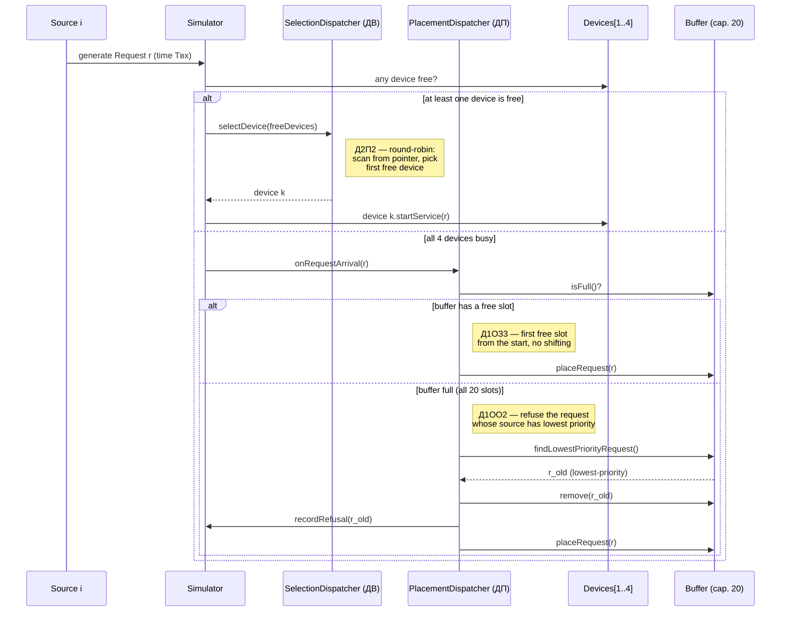
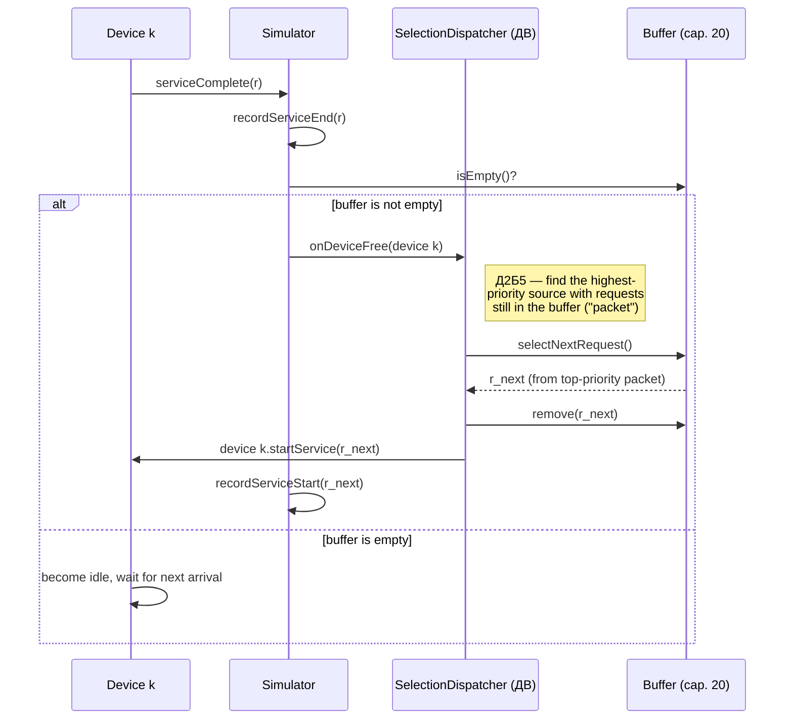

# СМО — Вариант 24. Первичные артефакты (диаграмма классов + диаграммы последовательности)

Домен: **Commodity Trading and Supply Chain Management Platform**
Вариант 24: `ИБ · ИЗ2 · ПЗ1 · Д1ОЗ3 · Д1ОО2 · Д2П2 · Д2Б5 · ОР1 · ОД3`

Эти диаграммы напрямую реализуют бизнес-домен и маппинг, согласованные с преподавателем:
5 источников (Buyer System, Supplier System, Logistics System, Warehouse/Inventory System,
Internal Trading System, приоритет = номер источника), буфер на 20 мест, 4 обработчика
(Worker 1–4), диспетчер постановки заявок **ДП** (Д1ОЗ3 + Д1ОО2) и диспетчер выбора заявок
**ДВ** (Д2П2 + Д2Б5) — оба являются алгоритмическими компонентами модели, не людьми.

## 1. Диаграмма классов


**Почему так:**
- `Source` — 5 экземпляров одного класса (не 5 подклассов), различаются только `name`/`priority`;
  `priority` одновременно и есть номер источника, используемый в Д1ОО2 и Д2Б5.
- `Request` = «Заявка» в финальном согласованном определении: одна целостная торговая/заказная
  операция от одного источника (не её внутренние шаги).
- `PlacementDispatcher` (ДП) отвечает только за то, что происходит, когда все приборы заняты —
  постановка в буфер (Д1ОЗ3) и, при переполнении, отказ (Д1ОО2).
- `SelectionDispatcher` (ДВ) отвечает за выбор прибора (Д2П2) и выбор заявки из буфера (Д2Б5) —
  оба метода используются и при немедленном обслуживании (выбор среди нескольких свободных
  приборов), и при освобождении прибора.
- `Statistics` отделена от `Simulator`, чтобы одинаково питать и ОР1 (сводная таблица), и ОД3
  (временные диаграммы/текущее состояние), не дублируя логику подсчёта.

## 2. Диаграмма последовательности — приход заявки




Покрывает все три исхода прихода заявки: немедленное обслуживание, постановка в буфер,
отказ. Важная деталь архитектуры: выбор прибора (Д2П2) — обязанность **ДВ**, а не ДП, даже
в момент прихода заявки — потому что это выбор прибора, а не постановка в буфер. ДП
подключается только когда свободных приборов нет.

## 3. Диаграмма последовательности — освобождение прибора




## Источники (source files)

- `class-diagram.mmd` / `.png`
- `sequence-arrival.mmd` / `.png`
- `sequence-device-free.mmd` / `.png`

GitHub рендерит блоки ```mermaid``` в этом файле автоматически — отдельно открывать `.png`
не обязательно, но они приложены на случай локального просмотра или вставки в отчёт.
