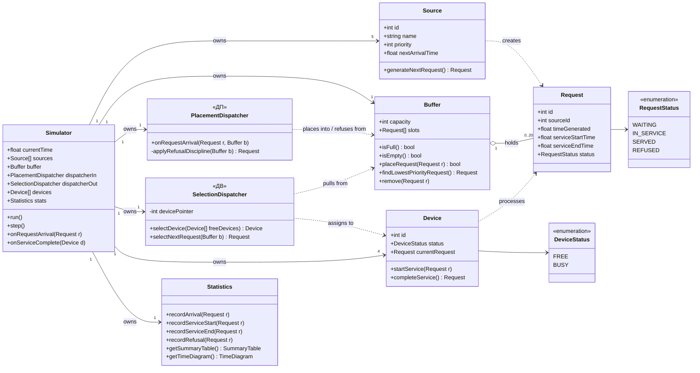
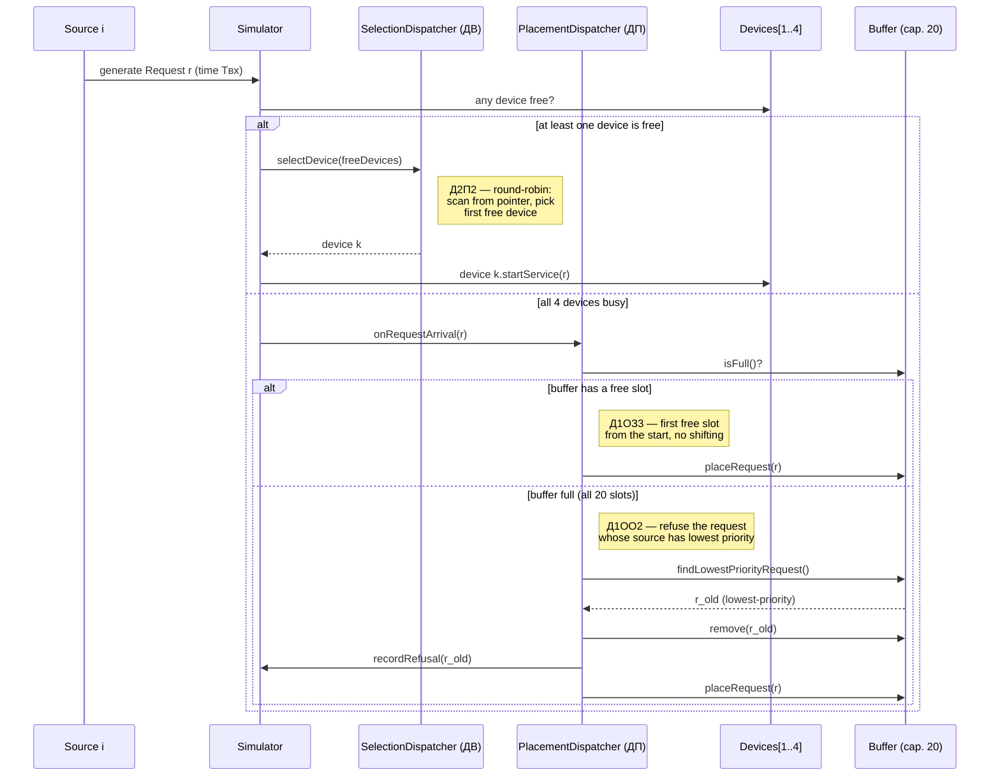
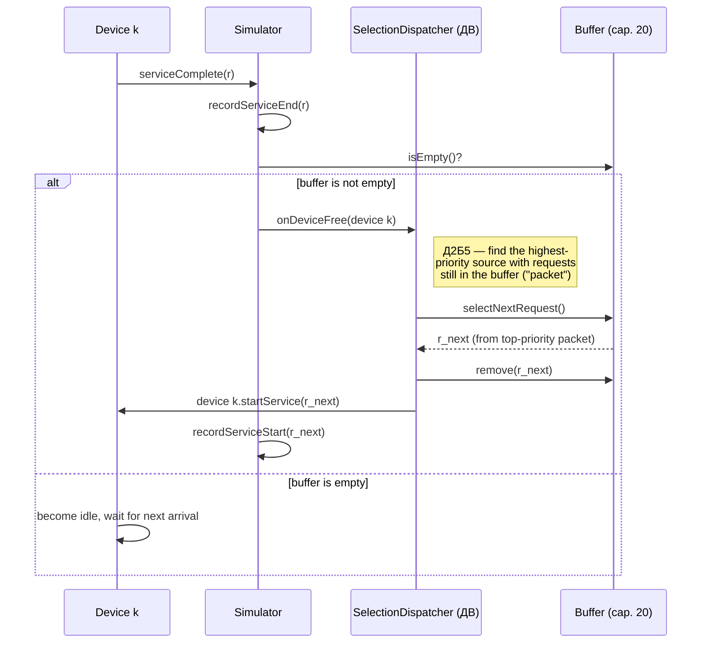

# СМО (Queuing System) — Variant 24. Primary Artifacts (Class Diagram + Sequence Diagrams)

Domain: **Commodity Trading and Supply Chain Management Platform**
Variant 24: `ИБ · ИЗ2 · ПЗ1 · Д1ОЗ3 · Д1ОО2 · Д2П2 · Д2Б5 · ОР1 · ОД3`

These diagrams implement the business domain and mapping already approved by the instructor:
5 sources (Buyer System, Supplier System, Logistics System, Warehouse/Inventory System,
Internal Trading System — priority = source number), a 20-slot buffer, 4 service devices
(Worker 1–4), a placement dispatcher **ДП** (disciplines Д1ОЗ3 + Д1ОО2), and a selection
dispatcher **ДВ** (disciplines Д2П2 + Д2Б5). Both dispatchers are algorithmic components of
the simulation model, not human roles — the codes (ИБ, ИЗ2, ПЗ1, Д1ОЗ3, Д1ОО2, Д2П2, Д2Б5,
ОР1, ОД3, ДП, ДВ) are kept exactly as specified by the course, since they're the official
variant-24 vocabulary and aren't meant to be translated.

## 1. Class Diagram

**Design notes:**
- `Source` is one class with 5 instances (not 5 subclasses) — they differ only in `name` and
  `priority`. `priority` doubles as the source number used by Д1ОО2 and Д2Б5.
- `Request` is the final, agreed definition of "Заявка": one complete trade/order operation
  from a single source (not its internal steps).
- `PlacementDispatcher` (ДП) only acts when every device is busy — it owns buffer placement
  (Д1ОЗ3) and, on overflow, refusal (Д1ОО2).
- `SelectionDispatcher` (ДВ) owns device selection (Д2П2) and buffer selection (Д2Б5) — both
  methods are used both for immediate service on arrival (choosing among several free devices)
  and when a device frees up later.
- `Statistics` is kept separate from `Simulator` so it can feed both ОР1 (summary table) and
  ОД3 (time diagrams / live state) without duplicating counting logic.

## 2. Sequence Diagram — Request Arrival

Covers all three possible outcomes of a request arriving: immediate service, buffering,
refusal. Key architectural point: device selection (Д2П2) is **ДВ**'s job, not ДП's, even at
the moment of arrival — because it's a device-selection decision, not a buffering decision.
ДП only gets involved once no device is free.

## 3. Sequence Diagram — Device Becomes Free

