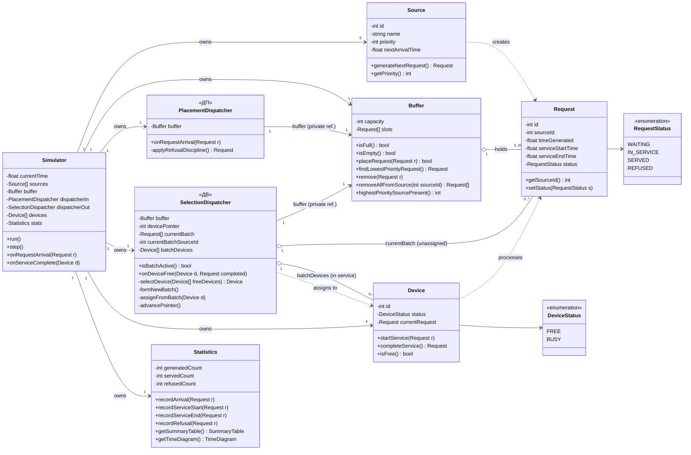
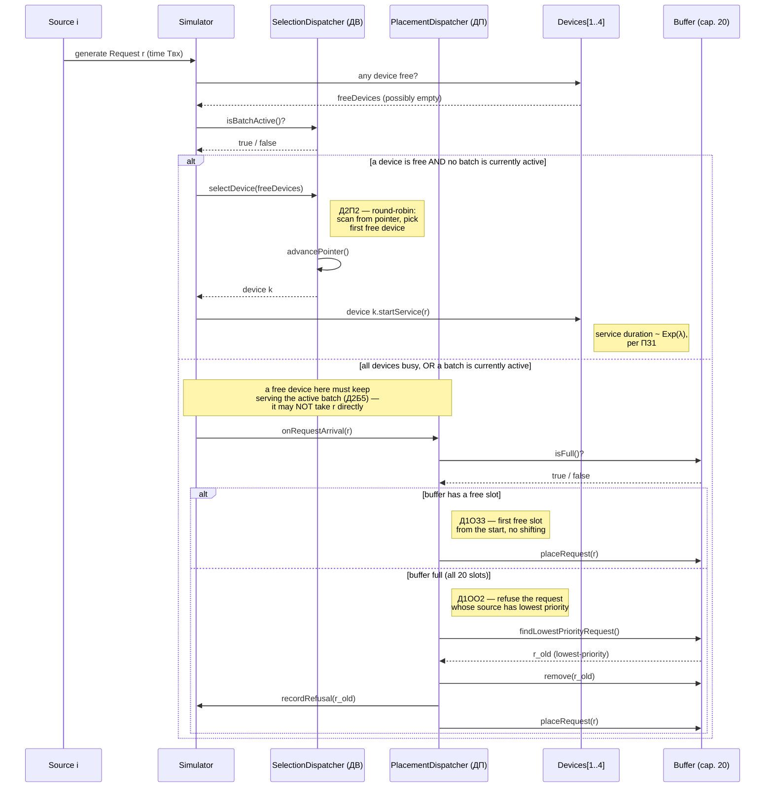
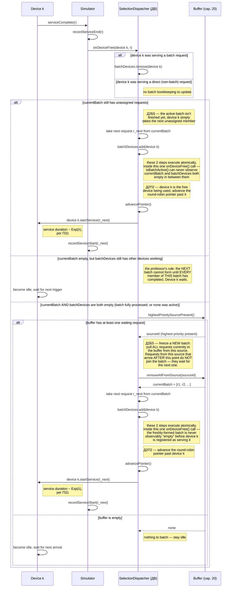

# СМО (Queuing System) — Variant 24. Primary Design Artifacts (Stage 2)

Domain: **Commodity Trading and Supply Chain Management Platform**
Variant 24: `ИБ · ИЗ2 · ПЗ1 · Д1ОЗ3 · Д1ОО2 · Д2П2 · Д2Б5 · ОР1 · ОД3`

These diagrams implement the business domain and mapping already approved by the instructor:
5 sources (Buyer System, Supplier System, Logistics System, Warehouse/Inventory System,
Internal Trading System — priority = source number), a 20-slot buffer, 4 service devices
(Worker 1–4), a placement dispatcher **ДП** (disciplines Д1ОЗ3 + Д1ОО2), and a selection
dispatcher **ДВ** (disciplines Д2П2 + Д2Б5). Both dispatchers are algorithmic components of
the simulation model, not human roles — the codes (ИБ, ИЗ2, ПЗ1, Д1ОЗ3, Д1ОО2, Д2П2, Д2Б5,
ОР1, ОД3, ДП, ДВ) are kept exactly as specified by the course, since they're the official
variant-24 vocabulary and aren't meant to be translated.

## 0. Stage 1 — Business Domain & Mapping (accepted)

- [hegazy_V24_BusinessDomain.pdf](hegazy_V24_BusinessDomain.pdf)
- [hegazy_V24_mapping.pdf](hegazy_V24_mapping.pdf)

## 1. Class Diagram

**Design notes:**
- `Source` is one class with 5 instances (not 5 subclasses) — they differ only in `name` and
  `priority`. `priority` doubles as the source number used by Д1ОО2 and Д2Б5.
- `Request` is the final, agreed definition of "Заявка": one complete trade/order operation
  from a single source (not its internal steps).
- Every attribute is **private** (`-`); only the operations a collaborator actually needs are
  public (`+`). Both dispatchers hold the `Buffer` through a **private** field rather than
  receiving it as a method parameter — so `PlacementDispatcher.onRequestArrival(Request r)` and
  `SelectionDispatcher.onDeviceFree(Device d, Request completed)` are the only entry points
  callers use; buffer access is an internal implementation detail of each dispatcher.
- `PlacementDispatcher` (ДП) only acts when every device is busy, or a Д2Б5 batch is active
  (see section 2) — it owns buffer placement (Д1ОЗ3) and, on overflow, refusal (Д1ОО2).
- `SelectionDispatcher` (ДВ) owns device selection (Д2П2, round-robin) and buffer/batch
  selection (Д2Б5). It keeps three private fields to track the currently-frozen batch's full
  lifecycle: `currentBatch` (the batch's requests not yet assigned to a device),
  `currentBatchSourceId` (which source the batch was frozen from), and `batchDevices` (the
  devices currently *in service* on a batch member — not yet finished). `isBatchActive()` is
  `true` while either of those is non-empty. See section 2 for the exact algorithm.
- `Statistics` is kept separate from `Simulator` so it can feed both ОР1 (summary table) and
  ОД3 (time diagrams / live state) without duplicating counting logic. `getTimeDiagram()` here
  only means "the data this class can supply for ОД3" — it is not a separate required diagram
  artifact at this stage.

## 2. Main Sequence Diagram — Full Request Lifecycle

This is the primary sequence diagram: it follows one request from generation all the way
through to service, showing every alternative branch required by variant 24 (immediate
service, buffering, eviction/refusal, and the batch-aware device-free path) inside a single
flow. Query messages that determine a branch (`any device free?`, `isBatchActive()?`,
`isFull()?`) show their explicit return value before the branch is taken.

```mermaid
sequenceDiagram
    participant S as Source i
    participant Sim as Simulator
    participant ДВ as SelectionDispatcher (ДВ)
    participant ДП as PlacementDispatcher (ДП)
    participant D as Devices[1..4]
    participant B as Buffer (cap. 20)

    loop every inter-arrival interval (ИЗ2 — uniform distribution)
        S->>Sim: generate Request r (time Tвх)
        Sim->>D: any device free?
        D-->>Sim: freeDevices (possibly empty)
        Sim->>ДВ: isBatchActive()?
        ДВ-->>Sim: true / false

        alt a device is free AND no batch is currently active
            Sim->>ДВ: selectDevice(freeDevices)
            Note right of ДВ: Д2П2 — round-robin:<br/>scan from pointer, pick<br/>first free device
            ДВ->>ДВ: advancePointer()
            ДВ-->>Sim: device k
            Sim->>D: device k.startService(r)
            Note right of D: service duration ~ Exp(λ),<br/>per ПЗ1
        else all devices busy, OR a batch is currently active
            Note over Sim,ДП: a free device here must keep<br/>serving the active batch (Д2Б5) —<br/>it may NOT take r directly
            Sim->>ДП: onRequestArrival(r)
            ДП->>B: isFull()?
            B-->>ДП: true / false
            alt buffer has a free slot
                Note right of ДП: Д1ОЗ3 — first free slot<br/>from the start, no shifting
                ДП->>B: placeRequest(r)
            else buffer full (all 20 slots)
                Note right of ДП: Д1ОО2 — evict the buffered<br/>request whose source has<br/>the lowest priority
                ДП->>B: findLowestPriorityRequest()
                B-->>ДП: r_old (lowest-priority)
                ДП->>B: remove(r_old)
                ДП->>Sim: recordRefusal(r_old)
                ДП->>B: placeRequest(r)
                Note over B: r now waits in the buffer
            end
        end
    end

    Note over D,B: ... simulated time passes, eventually<br/>a device finishes the request it was serving ...

    D->>Sim: serviceComplete(r_prev)
    Sim->>Sim: recordServiceEnd(r_prev)
    Sim->>ДВ: onDeviceFree(device k, r_prev)

    alt device k was serving a batch request
        ДВ->>ДВ: batchDevices.remove(device k)
    else device k was serving a direct (non-batch) request
        Note right of ДВ: no batch bookkeeping to update
    end

    alt currentBatch still has unassigned requests
        Note right of ДВ: Д2Б5 — the active batch isn't<br/>finished yet, device k takes the<br/>next unassigned member
        ДВ->>ДВ: take next request from currentBatch
        ДВ->>ДВ: batchDevices.add(device k)
        Note right of ДВ: these 2 steps execute atomically,<br/>inside this one onDeviceFree() call —<br/>isBatchActive() can never observe<br/>currentBatch and batchDevices both<br/>empty in between them
        ДВ->>ДВ: advancePointer()
        ДВ->>D: device k.startService(r)
        Note right of D: service duration ~ Exp(λ),<br/>per ПЗ1
        Sim->>Sim: recordServiceStart(r)
    else currentBatch empty, but batchDevices still has other devices working
        Note right of ДВ: the professor's rule: the NEXT<br/>batch cannot form until EVERY<br/>member of THIS batch has<br/>completed. Device k waits.
        D->>D: become idle, wait for next trigger
    else currentBatch AND batchDevices are both empty (batch fully processed)
        ДВ->>B: highestPrioritySourcePresent()
        B-->>ДВ: sourceId i (now the highest-priority<br/>source still waiting — e.g. r's source)
        Note right of ДВ: Д2Б5 — freeze a NEW batch:<br/>pull ALL of source i's requests<br/>currently in the buffer at once<br/>(including r). Requests from<br/>source i that arrive after this<br/>point do NOT join this batch.
        ДВ->>B: removeAllFromSource(sourceId)
        B-->>ДВ: currentBatch = [..., r, ...]
        ДВ->>ДВ: take next request from currentBatch
        ДВ->>ДВ: batchDevices.add(device k)
        Note right of ДВ: these 2 steps execute atomically,<br/>inside this one onDeviceFree() call —<br/>the freshly-formed batch is never<br/>observably "empty" before device k<br/>is registered as serving it
        ДВ->>ДВ: advancePointer()
        ДВ->>D: device k.startService(r)
        Note right of D: service duration ~ Exp(λ),<br/>per ПЗ1
        Sim->>Sim: recordServiceStart(r)
    end

    Note over Sim,D: Request r has now been generated,<br/>survived an eviction round in the<br/>buffer, waited for the prior batch<br/>to fully clear, and been placed<br/>into service — its full lifecycle.
```

**Д2Б5 — the frozen-batch discipline, stated precisely:**

1. A batch is identified by `currentBatchSourceId` and is considered **active** for as long as
   `currentBatch` (its unassigned members) or `batchDevices` (devices still in service on one of
   its members) is non-empty — i.e. `isBatchActive() = !currentBatch.isEmpty() ||
   !batchDevices.isEmpty()`.
2. A new batch forms only when **no** batch is active: ДВ finds the highest-priority source
   with requests still waiting in the buffer and freezes **all** of that source's
   currently-buffered requests into `currentBatch` in one step. Requests from that same source
   that arrive *after* the batch was frozen do **not** join it — they wait for the next batch.
3. Every device that frees while the batch is still active must draw its next request from
   `currentBatch`, if it still has unassigned members — never re-evaluate "what's the
   highest-priority source right now" mid-batch.
4. If `currentBatch` has been fully handed out (empty) but `batchDevices` is still non-empty,
   the batch is **not yet finished** — other devices are still processing its members. A newly
   freed device must simply **wait idle**; it must *not* trigger formation of the next batch.
   Only once the very last batch member completes (`currentBatch` and `batchDevices` both
   empty) does ДВ attempt to form the next batch.
5. **A newly-arrived request cannot bypass an active batch.** Even if a device happens to be
   free at the moment of arrival, if a batch is active that device belongs to the batch's
   service rotation, not to the new arrival — so the arrival is still routed through
   `PlacementDispatcher` (buffered, or evicts per Д1ОО2) exactly as if no device were free. Only
   when `isBatchActive()` is `false` does a free device take an arriving request directly
   (Д2П2, immediate round-robin assignment).
6. **`batchDevices` bookkeeping is race-free by construction.** A device is removed from
   `batchDevices` only when its service completes (the very first step of `onDeviceFree()`,
   before anything else runs). A device is added to `batchDevices` in the same breath as it is
   handed a request out of `currentBatch` — those two self-messages (`take next request from
   currentBatch` / `batchDevices.add(device k)`) are two statements inside one atomic
   `onDeviceFree()` call, with no other event able to interleave between them in this
   single-threaded, event-driven simulator. So `isBatchActive()` can never be queried — by an
   arriving request, or by anything else — at a moment where `currentBatch` has just been
   decremented but `batchDevices` hasn't been incremented yet; that transient state is never
   externally observable. Both sequence diagrams in sections 2 and 3.2 call this out explicitly
   with a note at each of the two places this matters (forming a brand-new batch, and handing
   an existing batch's next member to a freed device).

Device selection itself stays round-robin (Д2П2) and independent of which batch is active — the
pointer always advances past whichever device was just used, in both the direct-assignment and
the batch-assignment paths. Service duration for every `startService(r)` call, whether direct
or from a batch, follows ПЗ1 (exponential distribution).

## 3. Supplementary Sequence Diagrams

The two diagrams below isolate the two trigger events from the main sequence diagram above
(a request arriving, and a device becoming free) as standalone views, useful when discussing
one event in isolation. They implement exactly the same corrected Д2Б5 rules as section 2.

### 3.1 Request Arrival

### 3.2 Device Becomes Free

## 4. Flowchart with Swimlanes

Required design artifact: the full process as a flowchart, with responsibilities separated by
swimlane (one lane per actor — Source, Simulator, Placement Dispatcher, Buffer, Selection
Dispatcher, Worker/Device). It covers both branches of variant 24 (successful immediate
processing and the buffering/eviction path) and the full, corrected Д2Б5 batch-completion
lifecycle, including the rule that a new batch cannot form while any device is still serving a
member of the current one.

```mermaid
flowchart LR

    subgraph SRC["Source i"]
        direction TB
        A1(["Generate Request r<br/>at interval ИЗ2<br/>(uniform distribution)"])
    end

    subgraph SIM["Simulator"]
        direction TB
        B1{"Any device<br/>free right now?"}
        B1b{"ДВ.isBatchActive()?"}
        B2(["Device k reports<br/>serviceComplete(r)"])
    end

    subgraph DV["Selection Dispatcher (ДВ)"]
        direction TB
        C1["selectDevice(freeDevices)<br/>Д2П2 — round-robin:<br/>scan from pointer,<br/>pick first free device"]
        C2["advancePointer()"]
        C0{"device k was serving<br/>a batch request?"}
        C0b["batchDevices.remove(device k)"]
        C3{"currentBatch has<br/>unassigned requests?"}
        C3b{"batchDevices still has<br/>other devices working<br/>on this batch?"}
        C4["highestPrioritySourcePresent()"]
        C5{"Buffer has at least<br/>one waiting request?"}
        C6["Д2Б5 — freeze a NEW batch:<br/>removeAllFromSource(sourceId).<br/>Later arrivals from this source<br/>do NOT join this batch."]
        C7["take next request<br/>from currentBatch"]
        C7b["batchDevices.add(device k)"]
        C8["advancePointer()"]
    end

    subgraph DP["Placement Dispatcher (ДП)"]
        direction TB
        D1["onRequestArrival(r)"]
        D2{"Buffer isFull()?"}
        D3["Д1ОЗ3 — placeRequest(r)<br/>in first free slot,<br/>no shifting"]
        D4["Д1ОО2 — findLowestPriorityRequest()"]
        D5["remove(r_old),<br/>recordRefusal(r_old)"]
        D6["placeRequest(r)"]
    end

    subgraph BUF["Buffer (capacity 20)"]
        direction TB
        E1[("buffered requests,<br/>grouped by source")]
    end

    subgraph DEV["Worker(s) / Device"]
        direction TB
        F1["Device k: startService(r)"]
        F2(["Device k: BUSY,<br/>serving request<br/>(duration ~ Exp(λ), ПЗ1)"])
        F3["Device k: completeService()"]
        F4(["Device k: idle —<br/>nothing left to batch,<br/>wait for next arrival"])
        F5(["Device k: idle —<br/>batch still in progress<br/>on other devices"])
    end

    %% --- Arrival path ---
    A1 -- "triggers" --> B1
    B1 -- "yes, a device is free" --> B1b
    B1 -- "no, all 4 busy" --> D1
    B1b -- "no batch active —<br/>direct assignment" --> C1
    B1b -- "yes, batch active —<br/>device must keep<br/>serving the batch" --> D1
    C1 --> C2
    C2 -- "device k assigned" --> F1

    D1 --> D2
    D2 -- "free slot available" --> D3
    D3 --> E1
    D2 -- "all 20 slots full" --> D4
    D4 --> D5
    D5 --> D6
    D6 --> E1

    %% --- Service path ---
    F1 --> F2
    F2 -- "service time elapses" --> F3
    F3 -- "triggers" --> B2
    B2 --> C0

    %% --- Device-free / Д2Б5 lifecycle ---
    C0 -- "yes" --> C0b
    C0b --> C3
    C0 -- "no" --> C3

    C3 -- "yes" --> C7
    C3 -- "no" --> C3b

    C3b -- "yes — batch not<br/>fully processed yet" --> F5
    C3b -- "no — batch fully<br/>processed, or none active" --> C4

    C4 -. "reads" .-> E1
    C4 --> C5
    C5 -- "yes" --> C6
    C6 -. "pulls all of that<br/>source's requests" .-> E1
    C6 --> C7
    C5 -- "no, buffer empty" --> F4

    C7 --> C7b
    C7b --> C8
    C8 -- "device k reused" --> F1
```

## 5. How the Artifacts Fit Together

- The **main sequence diagram** (section 2) is the authoritative, complete picture of a
  request's lifecycle and should be read first.
- The **two supplementary sequence diagrams** (section 3) isolate its two trigger events for
  closer inspection.
- The **flowchart with swimlanes** (section 4) gives the same process from a control-flow /
  responsibility-ownership angle, rather than a message-exchange angle.
- The **class diagram** (section 1) is the static structure all of the above diagrams assume:
  every message and every decision box in the dynamic diagrams corresponds to a public
  operation or a private field already declared there.
